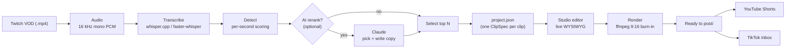

# ZonClip

**Turn a Twitch VOD into ready-to-post vertical clips — automatically, locally, and for free.**

ZonClip transcribes a stream locally (GPU acceleration when available), finds clippable moments, and renders each
as 9:16 shorts (facecam on top, gameplay on the bottom, animated word-by-word captions, a follow
watermark, and a hook titlecard). The VOD target is 45 individual clips plus up to 15 score-ranked compilations (three clips per compilation). A local **ZonClip Studio** app lets you trim, restyle, and fine-tune every
clip with a live WYSIWYG preview — then post or schedule to **YouTube Shorts**, **TikTok**, and **Instagram Reels**
without leaving the app. It also assembles long-form 16:9 YouTube videos from the same VOD.

The default clipping workflow is local and does not require a paid AI API. Anthropic-powered writing/reranking remains an optional, explicitly enabled add-on.

> Fully configurable — ZonClip ships with neutral defaults; set your own handle and persona in one
> local JSON file (see [Make it yours](#make-it-yours)). No creator-specific account credentials or API keys are baked in.

---

## How it works



Full design notes: **[docs/ARCHITECTURE.md](docs/ARCHITECTURE.md)**.

---

## Features

- **Local transcription** with cached word timestamps — faster-whisper defaults to the lighter
  `small.en` model with CPU int8 support; CUDA acceleration is used when available, and an installed
  whisper.cpp/Vulkan backend can be selected for supported AMD systems.
- **Automatic moment detection** — per-second scoring on six audio/text signals
  (energy, spike, sustain, talk-density, laughter, dynamics), tuned to favour real gameplay reactions
  over lobby chatter, snapped to sentence boundaries.
- **Optional AI pass** (Claude): re-rank the shortlist, write per-platform copy (a high-energy TikTok
  caption vs a searchable YouTube title, in an authentic voice with no emojis or em dashes), and apply
  plain-English edits. The local clipping pipeline works without it; automatic external-AI use is disabled unless `ai_enabled` is explicitly enabled in your local config.
- **The Studio** — a native desktop window (no browser chrome) with a true live preview: add text,
  shapes, arrows, emojis, images, a chat inset, and a hook titlecard, and they appear instantly on the
  video. Trim, splice in more of the stream, restyle captions, approve, and batch-render.
- **One-click posting & scheduling** to YouTube Shorts and TikTok from inside the app.
- **Long-form** — assembles 20–90 min 16:9 YouTube videos (chapters, captions, descriptions) from the
  same VOD, into a separate folder.

---

## Requirements

- **Windows 10/11** (the app uses Windows launchers, a native WebView2 window, and `%USERPROFILE%` paths).
- **Python 3.11 or 3.12** (the installer currently targets these versions).
- **ffmpeg + ffprobe** on `PATH` (or installed via WinGet — `winget install Gyan.FFmpeg`).
- **A GPU is recommended** for fast transcription:
  - **NVIDIA** → CUDA via faster-whisper (installed by `setup.ps1`).
  - **AMD** → whisper.cpp with a Vulkan build (drop the prebuilt `whisper-cli` binary in
    `<clipforge-home>/whispercpp/` — see [docs/ARCHITECTURE.md](docs/ARCHITECTURE.md#transcription)).
  - **No GPU** → runs on CPU (much slower; fine for short clips/tests).
- Optional: an **Anthropic API key** for the AI features.

---

## Install

```powershell
git clone https://github.com/Tahir1907/ZonClip.git
cd ZonClip\clipper

# one-time setup: creates a local venv, installs deps, copies caption fonts, builds the watermark
powershell -ExecutionPolicy Bypass -File .\setup.ps1
```

`setup.ps1` creates everything under your **ClipForge home** (default `%USERPROFILE%\clipforge`) and
installs the free local dependencies from `requirements.txt`. Optional Anthropic features are kept separate in
`requirements-ai.txt` and may incur API charges; they are disabled by default and are not needed for clipping. To use them, explicitly set `ai_enabled` to `true` in your local `config.json` and install `requirements-ai.txt`. If you have an NVIDIA GPU it also installs the
CUDA wheels.

Prefer to do it by hand?

```powershell
cd clipper
python -m venv "$env:USERPROFILE\clipforge\.venv"
& "$env:USERPROFILE\clipforge\.venv\Scripts\python.exe" -m pip install -r requirements.txt
```

---

## Run

**ZonClip Studio (recommended):**

```powershell
cd clipper
$env:PYTHONPATH = (Get-Location)
& "$env:USERPROFILE\clipforge\.venv\Scripts\python.exe" dashboard.py
```

…or double-click **`clipper\ClipForge.vbs`** for a quiet launch with no terminal window. The first launch automatically creates a **ClipForge Studio** shortcut on your Windows Desktop; after that, just double-click the desktop icon. It uses the existing local virtual environment and opens the native WebView2 Studio window. Keep `ClipForge.bat` as a console-visible troubleshooting launcher.

1. Drop your stream recordings (`.mp4`) in your **Videos** folder (or point `CLIPFORGE_LIBRARY`
   elsewhere). They appear on the Home screen.
2. **🎬 Make clips** (or **🎞 Longform**) on a VOD. ZonClip transcribes, detects, and renders.
3. Review and fine-tune each clip in the editor.
4. **⬇ Download** a clip to render the final burned-in file, then **🚀 Post** it (see
   [Posting](#posting-to-youtube--tiktok)).

Tidy up from Home anytime: **🗑** on a video moves it to the **Recycle Bin** (recoverable), and **🗑**
on a clip batch deletes just those rendered clips — your source recording is left untouched.

**From the command line** (one-off, no UI):

```powershell
$env:PYTHONPATH = (Get-Location)
& "$env:USERPROFILE\clipforge\.venv\Scripts\python.exe" clip.py "C:\path\to\your-vod.mp4" --ai
```

`clip.py` flags: `--count N` · `--ai` (Claude picks + writes copy) · `--limit-secs 900` (fast test on
the first 15 min) · `--dry-run` (detect only, no render) · `--dashboard` (render then open the Studio).

---

## Make it yours

ZonClip ships with neutral defaults. To personalise it **without editing any code**, drop a
`config.json` in your ClipForge home (`%USERPROFILE%\clipforge\config.json`). Any field from
[`pipeline/config.py`](clipper/pipeline/config.py) can be overridden:

```json
{
  "wm_handle": "yourhandle",
  "channel_name": "YourChannelName",
  "channel_persona": "a comedic gaming streamer",
  "clip_count": 12,
  "ai_enabled": false,
  "use_nvenc": true
}
```

- `wm_handle` — your Twitch @handle; shown in the follow watermark and the caption call-to-action.
- `channel_name` / `channel_persona` — used by the AI copywriter so titles/captions sound like you.
- …plus geometry, caption styling, detection weights, encoder choice, long-form settings, and more.

**Environment overrides:**

| Variable | Default | What |
|---|---|---|
| `CLIPFORGE_HOME` | `%USERPROFILE%\clipforge` | where the venv, models, cache, and `config.json` live |
| `CLIPFORGE_LIBRARY` | `%USERPROFILE%\Videos` | folder the Home picker scans for VODs + clip batches |
| `ANTHROPIC_API_KEY` | *(unset)* | optional external AI key; AI also requires `ai_enabled: true` in `config.json` |

---

## Posting to YouTube + TikTok

ClipForge can upload finished clips to your own channels and schedule them with a local timer.
It's **semi-automated and free**: YouTube uploads land **private** until you flip them public in
Studio (unverified API projects are locked private), and TikTok is delivered to your **inbox** (open the
app, tap the notification to add a caption and post). Full hands-off public posting requires each platform's audit, which
needs a public website — out of scope for a free, local tool.

You connect your own developer apps once (Google Cloud + TikTok for Developers) and paste the client
keys into the Studio's **🚀 Posting** panel; OAuth runs through the app's own loopback redirect, so no
public site is needed for sign-in. The queue records completed uploads per day and gives clearer
quota/rate-limit errors. Provider quotas vary by platform, account, and API project, so ZonClip does
not invent a universal hard-coded daily limit. Step-by-step setup is built into that panel and detailed in
[`clipper/README.md`](clipper/README.md#posting-setup).

---

## Repository layout

```
clipforge/
├─ README.md              ← you are here
├─ docs/
│  ├─ ARCHITECTURE.md     ← full architecture & data model
│  ├─ privacy.html        ← privacy policy (for the posting API app registrations)
│  └─ terms.html          ← terms of service
└─ clipper/
   ├─ dashboard.py        ← launches the Studio (native window)
   ├─ dashboard.html      ← the Studio UI (one vanilla-JS page)
   ├─ clip.py / longform.py / cfedit.py   ← CLI entry points
   ├─ ClipForge.bat / setup.ps1           ← Windows launcher + installer
   ├─ requirements.txt
   └─ pipeline/           ← the engine (see ARCHITECTURE.md)
      ├─ config.py        ← every tunable default (override via config.json)
      ├─ audio.py · transcribe.py · transcribe_whispercpp.py · detect.py
      ├─ rerank.py · ai_edit.py · meta.py        ← AI + metadata
      ├─ project.py · render.py · elements.py · captions.py · branding.py
      ├─ jobs.py · longform.py · camdetect.py
      ├─ server.py        ← stdlib HTTP server + JSON API for the Studio
      └─ posting.py       ← YouTube/TikTok OAuth, uploaders, scheduler
```

Heavy/private data lives **outside** the repo, under your ClipForge home: the venv, model cache,
transcript/work cache, API key (`secret.json`), posting tokens (`posting.json`), and your `config.json`.
Source VODs and rendered clips are never committed.

---

## Tech stack

Python (stdlib HTTP server, no web framework) · ffmpeg/libass for rendering · whisper.cpp (Vulkan) &
faster-whisper (CUDA) for transcription · Pillow + NumPy for frames/audio · pywebview (WebView2) for the
native window · vanilla JS for the editor · the Anthropic, Google API, and TikTok APIs for the optional
AI and posting features.

## License & disclaimer

A free, personal, open-source project. Provided as-is, with no warranty. Not affiliated with Twitch,
YouTube, Google, or TikTok. You are responsible for the content you upload and for complying with each
platform's terms.


## Current implementation scope

The current release is a **local Windows application**. The Studio UI, AI models, transcription, clip detection, rendering, project files, and publishing queue run on your PC. There is no hosted dashboard, cloud rendering, remote processing agent, or cloud storage. Internet access is used only for optional model downloads and official platform sign-in/publishing.

See [the Windows test plan](docs/TEST_PLAN.md) before running your first test.

## Live clipping

ZonClip can watch completed OBS recording segments and process them continuously into a session-wide, unlimited highlight queue. It also builds ranked compilation parts when the session is stopped. This uses local recording files and the existing VOD pipeline; it does not ingest a remote stream URL directly.

See [Live mode setup](docs/LIVE_MODE.md) for OBS configuration, commands, outputs, and current limitations.

## Instagram Reels publishing

ZonClip includes an official Meta Instagram Reels publishing integration using the Facebook Login resumable upload flow. It requires an eligible Business/Creator account linked to a Facebook Page, Meta app credentials, and the permissions/access Meta grants. See [Instagram setup](docs/INSTAGRAM_SETUP.md) before connecting an account.


## Local-only architecture

ZonClip runs as a Windows desktop application. Its local HTTP server binds to loopback only and is opened inside the native desktop window (with a local browser fallback). No Vercel deployment or hosted web dashboard is part of the project.
